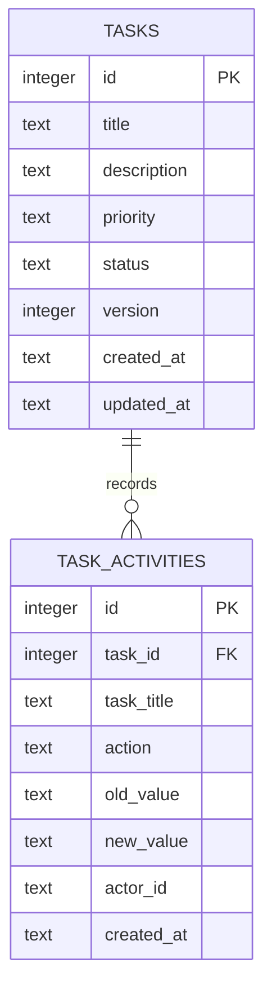

# Database Design
## ER diagram

## Tables
| Table | Purpose | Primary key | Foreign key |
|---|---|---|---|
| tasks | Current task state | id | — |
| task_activities | Append-only task event history | id | task_id → tasks.id, ON DELETE SET NULL |
## Constraints
- Task title is required and 1–120 trimmed characters; description is at most 2,000 characters.
- Priority is Low, Medium or High; status is Todo, In Progress or Done.
- Version is a positive integer used for optimistic concurrency.
- Activity action is one of created, edited, status_changed or deleted.
- Task deletion sets activity.task_id to NULL; task_title and old_value preserve a readable deletion record.
## Indexes
| Index | Query | Reason |
|---|---|---|
| idx_tasks_status_priority_updated | Status/priority filters and updated order | Supports common filtered list access |
| idx_tasks_created_at | Created-time ordering | Supports created date sort |
| idx_activities_task_created | Per-task chronological history | Efficient timeline retrieval |
## Lifecycle and normalization
Tasks store current state; task_activities stores event snapshots as JSON text. This is a deliberate event snapshot for audit display. One task has many activity rows. Hard deletion removes the task row but preserves activity rows using ON DELETE SET NULL. Timestamps are UTC ISO strings. Seed data is synthetic and the seed script skips a non-empty database.
