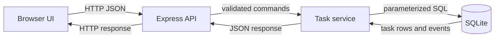
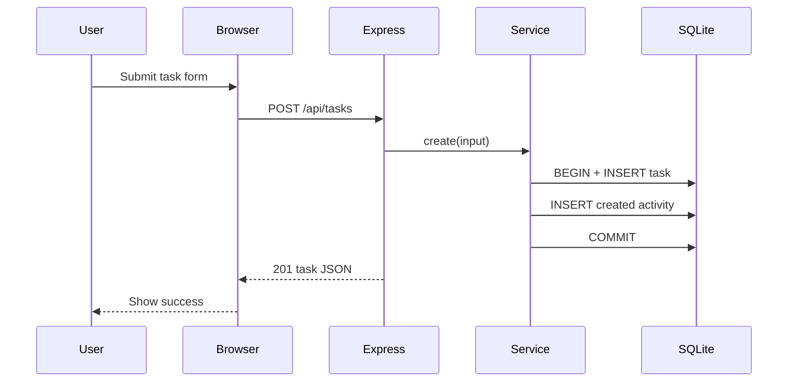
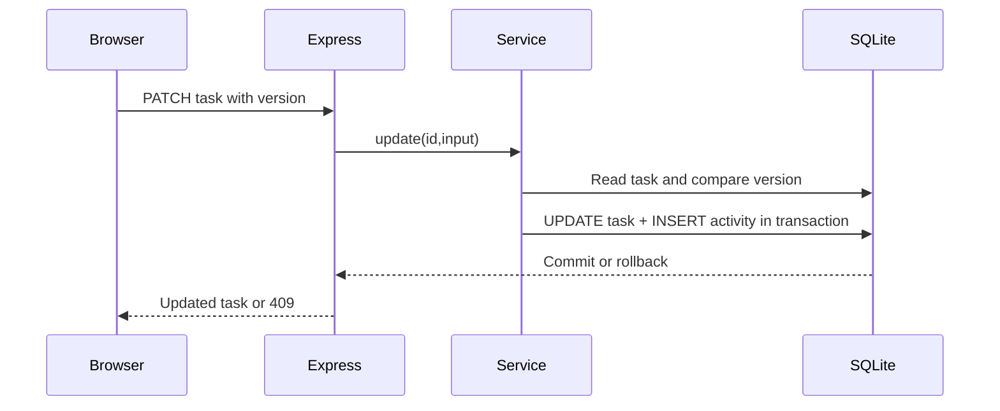

# High-Level Design — Mini Workflow Engine
## Context
A single-user browser application for creating, updating, filtering and tracking tasks. Authentication, multi-user collaboration, queues and external integrations are out of scope. Task writes and their activity events must commit atomically.
## System interaction flow

## Components
| Component | Responsibility | Input | Output |
|---|---|---|---|
| Browser UI | Forms, filters, list, details, timeline | User actions | HTTP requests |
| Express API | Routing, JSON parsing, error mapping | HTTP request | JSON response |
| Task service | Validation, task rules, transactions | Validated command | Task / history |
| SQLite | Durable relational storage | SQL statements | Rows |
## Key flow: create task

## Key flow: update task

## Boundaries and choices
- UI owns presentation and interaction only.
- Routes own HTTP concerns; service owns validation and business logic; database module owns connection and schema initialisation.
- Node.js + Express keeps the service small; SQLite provides a relational store with no paid infrastructure.
- better-sqlite3 transactions keep task and activity writes atomic.
## Failure handling
| Failure | Behaviour | Recovery |
|---|---|---|
| Invalid input | 422 with stable error shape | Correct the form |
| Missing task | 404 | Return to task list |
| Stale version | 409 conflict | Refresh and retry |
| Activity insert failure | Transaction rollback | Retry after correcting storage issue |
| Database unavailable | Generic 500; no SQL detail leaked | Restore database and retry |
## Production gaps
Authentication, authorization, backups, rate limiting, observability, CSRF strategy for cookie auth, deployment configuration and automated browser tests would be required before production.
